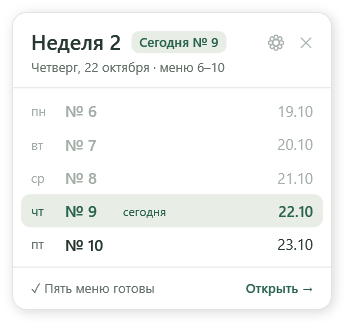
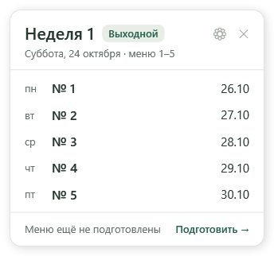

# Виджет, напоминания и обновления — версия 0.2.2

## Реализовано

- Закрытие крестиком и сворачивание скрывают окно у часов. Двойной щелчок по значку открывает его; меню значка содержит «Выйти». Повторный запуск открывает существующее окно. Положение и размер записываются отдельно от настроек; после отключения монитора окно возвращается на доступный экран.
- Настройка автозапуска создаёт задачу входа только текущего пользователя и запускает приложение в трее.
- Воскресное напоминание: включение, время ЧЧ:ММ, отключение и тестовая кнопка. Планировщик Windows запускает программу даже после выхода через трей; задача при входе в систему обрабатывает пропущенный срок. Выключенный компьютер не будится.
- Клик по системному уведомлению открывает окно «Открыть меню» / «Напомнить через 30 минут». Отложить можно и через трей. Срок хранится на диске, одноразовая задача переживает выход из программы. Несколько пропущенных недель дают одно актуальное напоминание. При включении в будний день старое воскресенье не воспроизводится.
- Проверка стабильного GitHub Release по кнопке, сравнение числовых версий, изменения, прогресс, отмена, ошибки сети и лимитов API. Загрузка начинается только по «Установить». Проверяются источник, схема манифеста, Windows x64, минимальная сборка Windows, размер и SHA-256. Неполная загрузка удаляется.
- Внешний автономный помощник повторно проверяет установщик, ждёт закрытия программы, запускает MSI и открывает приложение снова. Профиль `%LocalAppData%\MenuWidget` не входит в состав MSI. MajorUpgrade выполняется внутри транзакции Windows Installer; более ранняя версия не устанавливается поверх новой.
- MSI текущего пользователя, ярлыки рабочего стола и меню «Пуск», очистка автозапуска и задач при удалении. Данные меню после удаления остаются.

## Виджет на рабочем столе (после 0.2.2, не выпущено)

 

- Компактная карточка в правом верхнем углу экрана, по образцу Teacher Companion. Показывает номер недели цикла («Неделя 1» — меню 1–5, «Неделя 2» — меню 6–10), сегодняшнее меню («Сегодня № 9») и пять дней недели с датами; текущий день выделен, прошедшие приглушены. В субботу и воскресенье показывается следующая неделя и метка «Выходной».
- Щелчок по виджету открывает папку с последними подготовленными меню этой недели (полный комплект из пяти файлов, в том числе повторная выгрузка `yyyy-MM-dd_…`). Если меню ещё не подготовлены или цикл не настроен, открывается программа.
- Виджет перетаскивается мышью, положение запоминается в `widget.json`. ⚙ открывает программу, ✕ скрывает виджет; вернуть его можно из меню значка в трее («Показать виджет»). Скрытый виджет не показывается и при автозапуске.
- При обычном запуске и автозапуске открывается виджет; полное окно — при первом запуске (цикл не настроен) или если виджет скрыт. Виджет обновляется раз в 30 секунд и сразу после подготовки файлов и сохранения настроек. Режим «Поверх других окон» действует и на виджет.

## Устойчивость к ошибкам (после 0.2.2)

- Окно «Проверьте пять меню» больше не закрывает программу, если в ячейке нет даты, адрес набран не полностью или файл повреждён: ошибка показывается рядом с файлом. Общий обработчик пишет непредвиденные ошибки в `diagnostics.log` и показывает сообщение вместо аварийного закрытия.
- Повреждённый `settings.json` откладывается в `settings.broken-….json`, программа запускается с настройками по умолчанию и сообщает об этом. Повреждённые `window.json`, `widget.json` и `reminder-state.json` игнорируются. Повреждённый сохранённый комплект показывается пустым с пояснением, а не блокирует запуск.

## Техническое решение

Производственное уведомление использует WinForms NotifyIcon. Windows App SDK в локальном техническом стенде сообщил Unsupported; параметры безопасности Windows не менялись. Доступность визуального уведомления зависит от настроек уведомлений и режима «Не беспокоить». Программа не обходит их.

Планировщик регистрирует недельный и входной триггеры с интерактивным токеном текущего пользователя, без запроса прав администратора. Время воскресенья локальное; срок отложенного события хранится с UTC-смещением. Команды повторного запуска передаются именованными событиями, единственная копия определяется именованным mutex с SID пользователя.

## Выполненные короткие проверки

`./scripts/Build.ps1`: 48 синтетических проверок (с виджетом и восстановлением повреждённых настроек), включая календарь, сохранность XLSX, хранение комплектов и атомарный экспорт. Новые проверки охватывают воскресный срок, пропуск, отсутствие дублей, отложенный срок после перезапуска, перевод часов назад, сохранение положения, сравнение версий, отсутствие релизов, неподходящие архитектуру/источник/размер/хеш, prerelease, лимиты API и отмену. HTTP подменён локальным обработчиком; настоящий установщик в этих проверках не запускается.

`./scripts/Build-Release.ps1`: собран пользовательский MSI и согласованный с ним манифест. Это проверка сборки пакета, не доказательство установки на чистой Windows.

## Ручная проверка пользователем

1. Закрыть прежнюю тестовую версию. Открыть новую, сдвинуть окно, закрыть крестиком и восстановить двойным щелчком по значку у часов. Запустить ярлык повторно: второго окна быть не должно.
2. В настройках включить автозапуск и воскресное напоминание, выбрать время и сохранить. Нажать «Проверить уведомление». По уведомлению выбрать «Напомнить через 30 минут», выйти через трей и дождаться повторного сигнала. Для пропущенного срока проверить вход в Windows после наступления настроенного воскресного времени.
3. Для установленной версии проверить обновление после публикации следующего стабильного релиза с манифестом. Шаблоны, опорная дата и папка результата должны сохраниться. Отдельно проверить отмену установщика и удаление приложения с очисткой задач.

Ручная проверка реального показа уведомлений, входа в Windows, смешанного DPI и обновления между двумя опубликованными версиями остаётся за пользователем. По его просьбе автоматизация рабочего стола и длительные установочные прогоны не выполнялись. Тестовый prerelease 0.2.2 доступен по [ссылке](https://github.com/kuzmin-lemmi/MenuWidget/releases/tag/v0.2.2). Кнопка обновления ищет стабильный канал. Локальная установка, обновление через помощник и удаление проверены; детали в [отчёте выпуска](RELEASE_NOTES_0.2.2.md).
