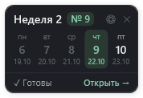

# MenuWidget 0.3.1 — компактный виджет и подготовка в один щелчок

Для Windows 11 x64. Установщик включает .NET: Excel, Python, SDK и дополнительные программы не требуются. Ставится поверх 0.2.2 и 0.3.0; шаблоны, настройки и подготовленные меню сохраняются.

## Что нового

  

- **Виджет стал в несколько раз меньше.** Сверху неделя цикла и сегодняшнее меню, ниже пять дней в одну строку: день, номер меню и дата.
- **Подготовка в один щелчок.** Если меню на неделю ещё не готовы, щелчок по виджету предлагает подготовить их из сохранённых шаблонов. После подтверждения откроется новая папка с пятью файлами. Шаблоны не меняются.
- **Щелчок по дню открывает файл этого дня**, щелчок в другом месте — папку недели.
- **«Пора!»** — в выходные и пока напоминание без ответа виджет выделяется, если меню ещё не готовы.
- **Настройки виджета**: тема (как в Windows, светлая, тёмная), угол экрана или своё место, непрозрачность фона 80–100 %, закрепление от случайного перемещения.
- **Свой значок** — зелёная «М» у программы, ярлыков и в трее вместо стандартного значка Windows.

## Исправления

- Напоминание больше не пропадает, если не нажать на уведомление сразу: оно повторяется каждые 30 минут, пока вы не отреагируете, и программа не закрывается сама.
- Старые скачанные обновления и лишние копии шаблонов удаляются автоматически, папка данных больше не растёт.
- Неправильная «Папка готовых меню» сразу показывается ошибкой при сохранении настроек, а не при подготовке файлов.

## Проверки и ограничения

Проходят 50 синтетических проверок, включая очистку старых файлов и копий шаблонов. Новые элементы виджета, тёмная тема, подготовка в один щелчок и повтор напоминания на живом рабочем столе ещё не проверялись — напишите, если что-то работает не так.

Установщик не подписан: Windows может предупредить о неизвестном издателе. Реальные меню и личные настройки в выпуск не включены.
