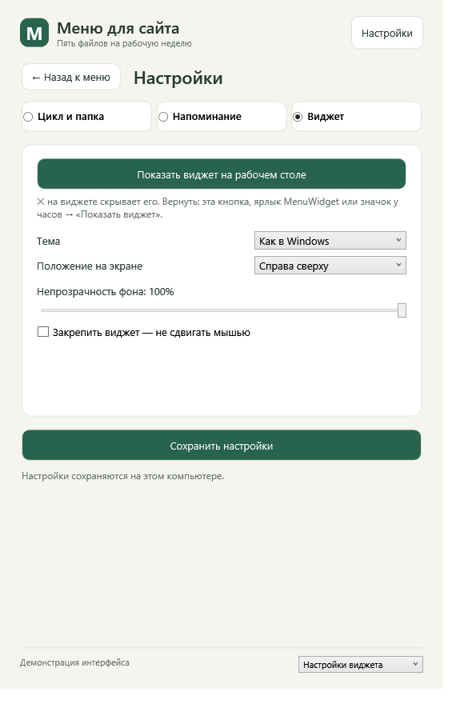

# MenuWidget 0.3.2 — настройки без прокрутки

Для Windows 11 x64. Ставится поверх 0.2.2–0.3.1; шаблоны, настройки и подготовленные меню сохраняются.

## Что нового

- **Виджет легко вернуть.** На вкладке «Виджет» в настройках есть кнопка «Показать виджет на рабочем столе». Запуск программы с ярлыка тоже всегда показывает виджет, даже если его скрыли крестиком; повторный запуск ярлыка открывает окно программы. При автозапуске скрытый виджет остаётся скрытым.
- **Больше никаких вертикальных прокруток.** Настройки разбиты на вкладки «Цикл и папка», «Напоминание» и «Виджет». Если окно программы или окно проверки пяти меню не помещается по высоте экрана, содержимое уменьшается целиком.
- Описание новой версии на экране обновлений показывается коротко, полный текст — по ссылке на GitHub.

## Проверки и ограничения

Проходят 50 синтетических проверок; экраны настроек и обновлений проверены на демонстрационных снимках. На живом рабочем столе изменения ещё не проверялись.

Установщик не подписан: Windows может предупредить о неизвестном издателе.
