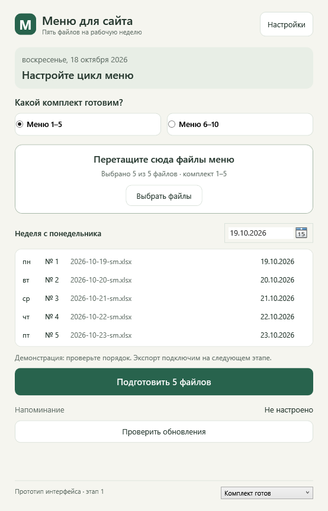
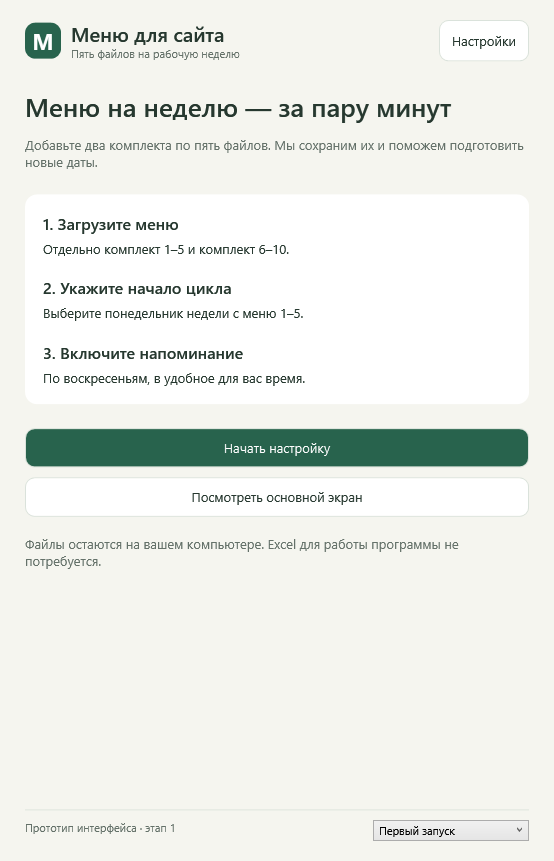
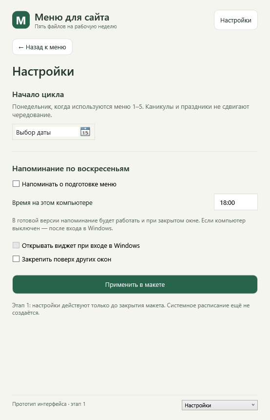

# Этап 1: макет и техническая основа

Статус: **начат, выполнена первая часть**. Это не готовый релиз. Установку, системные уведомления и обновление ещё нельзя считать проверенными.

## Что реализовано

- Собираемое решение C#/.NET с WPF-прототипом.
- Семь демонстрационных экранов: первый запуск, пустой комплект, два файла из пяти, пять файлов, ошибка, настройки и обновления.
- Выбор комплектов, выбор даты, приём имён файлов через диалог и drag-and-drop. Выбранные имена показываются по дням; чтение содержимого, перестановка и сохранение комплектов ещё не подключены.
- Поля опорного понедельника, включения напоминания и времени. Настройки прототипа действуют только в памяти; системное расписание не создаётся.
- Экран обновления явно обозначает, что установка ещё не подключена. Кнопка установки недоступна.
- Календарное ядро и интерфейсы сервисов. Спецификация контрактов — в `src/MenuWidget.Core/Contracts.cs`.
- Отдельный технический эксперимент точечной замены даты в XLSX. Он не подключён к экспорту из интерфейса и не объявлен готовым производственным редактором.
- Сценарий сборки и CI для Windows. CI публикует артефакт прототипа, не GitHub Release.

## Макет

Внизу прототипа находится переключатель демонстрационных состояний; в конечной программе его не будет. Приём файлов в макете не меняет документы. «Подготовить 5 файлов» объясняет, что экспорт появится на следующем этапе, и не сообщает о фиктивном успехе.

### Основной экран



### Первый запуск



### Настройки



### Остальные состояния

- [Нет файлов](design/empty.png)
- [Часть файлов](design/partial.png)
- [Ошибка](design/error.png)
- [Обновления](design/updates.png)

Макет пока не согласован пользователем. Скриншоты — реальные отрисовки WPF, не изображения будущих реализованных функций.

## Выполненные проверки

Локально на Windows build 26200 x64, SDK 10.0.402:

- Release-сборка Core, Probes и WPF завершена без ошибок и предупреждений.
- 15 технических проверок: 9 календарных, 2 проверки сохранности XLSX для систем дат 1900/1904 и 4 проверки отказа от опасной/неподдержанной записи.
- Во временном каталоге генерируются только искусственные книги. Реальные школьные файлы не читаются.
- Проверяется неизменность хэша исходника, состава архива, всех неизменяемых частей побайтово, всех ячеек листа кроме выбранной семантически, старого общего стиля, формулы и её кэша, настроек печати, объединений и скрытых строк.
- Книга с двумя листами разрешает целевой лист через relationships и нестандартное имя XML. Проверяется отказ от записи поверх исходника/готового файла, формулы и отсутствующей ячейки.
- Семь экранов отрисованы и просмотрены. Исправлены контраст текста кнопок и обрезание основного действия.
- Self-contained Windows x64 EXE собран и отдельно запущен: код выхода 0, все семь экранов отрисованы. Это проверка автономного запуска на текущей машине, не проверка установщика на чистой Windows.

Эти проверки доказывают сохранность содержимого в рамках искусственных примеров. Они не заменяют будущую проверку результатов в Excel/LibreOffice и полного импорта реальных разновидностей шаблонов. Разные виды повреждений/защиты ещё не покрыты исчерпывающе.

## Решения и открытые проверки

| Область | Решение на этапе 1 | Статус |
| --- | --- | --- |
| Интерфейс | C# + WPF, .NET 10 LTS; SDK зафиксирован в global.json | Собрано локально |
| Целевая платформа | Первой проверяем Windows 11 x64. Windows 10 и ARM64 пока не заявляются поддержанными | Чистая машина ещё нужна |
| Excel | Точечная правка OOXML в ZIP; клонирование формата только выбранной ячейки | Прототип прошёл синтетические проверки |
| Уведомления | Windows App SDK AppNotificationManager + отдельный запуск планировщиком | Исследовано по документации, интеграция не выполнена |
| Установщик | Кандидат: WiX MSI с EXE bootstrapper, пользовательская установка и транзакционный major upgrade | Выбор окончательно подтвердить после пробы install/upgrade/rollback |
| Обновление | Стабильные GitHub Releases, манифест и SHA-256, запуск установщика после действия пользователя | Контракт и макет готовы, интеграция не выполнена |

Почему упаковка остаётся открытой: сама возможность скачать EXE не доказывает безопасный откат, сохранность данных и работу регистрации уведомлений. Следующая часть этапа 1 — отдельная установленная проба этих сценариев.

## Воспроизводимость

Для разработчика: Windows, .NET SDK из `global.json`, PowerShell. SDK не требуется конечному пользователю будущего self-contained релиза.

```powershell
./scripts/Build.ps1
./scripts/Build.ps1 -Capture
./scripts/Build.ps1 -PublishPrototype
```

Скрипт использует `.tools/dotnet/dotnet.exe`, если SDK установлен локально, иначе `dotnet` из PATH. Можно передать `-DotnetPath`. Проверки запускаются как консольный технический стенд, не через `dotnet test`.

Запуск исходного прототипа:

```powershell
dotnet run --project src/MenuWidget.Prototype -c Release
```

После self-contained публикации запуск без SDK: `artifacts/prototype/MenuWidget.Prototype.exe`. Это интерфейсный прототип без установщика и функций рабочего экспорта, не релиз для распространения пользователям.

## Следующая часть этапа 1

1. Проверить установленное приложение с уведомлением при закрытом UI и активацией по нажатию.
2. Проверить две локальные версии установщика: успешный upgrade, отказ/ошибка, откат, сохранность данных.
3. Подтвердить выбор упаковки и политику подписи, затем перенести результат в архитектуру.
4. Проверить макет при разных DPI, клавиатуру и сценарий перетаскивания на реальном рабочем столе; учесть обратную связь по внешнему виду.
5. Только после этих проверок закрыть этап 1 и переходить к производственному импорту/экспорту этапа 2.

## Первичные источники

- [.NET support policy](https://dotnet.microsoft.com/en-us/platform/support/policy/dotnet-core)
- [WPF и drag-and-drop](https://learn.microsoft.com/en-us/dotnet/desktop/wpf/advanced/drag-and-drop)
- [Выбор API уведомлений](https://learn.microsoft.com/en-us/windows/apps/develop/notifications/)
- [App notifications для WPF/.NET](https://learn.microsoft.com/en-us/windows/apps/develop/notifications/app-notifications/app-notifications-dotnet)
- [WiX MajorUpgrade и порядок отката](https://docs.firegiant.com/wix/schema/wxs/majorupgrade/)
